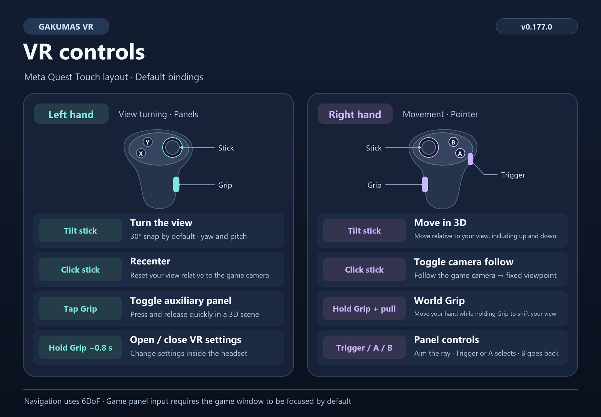

[한국어](README.md) | [English](README.en.md) | [日本語](README.ja.md)

# Gakumas VR

Creator: [@TBluebox12](https://x.com/TBluebox12)  
ArcaLive virtual reality channel: [가상현실 채널](https://arca.live/b/vrshits)  
Support: [buymeacoffee.com/vrshits](https://buymeacoffee.com/vrshits)

Gakumas VR is an unofficial Meta Quest/OpenXR VR mod for the DMM version of Gakuen Idolmaster. Supported 3D scenes are presented in stereo VR, while other content appears on aspect-correct flat panels that can be controlled with VR controllers.

The core 6DoF controls were hardware-tested on Meta Quest 2 with VDXR (Virtual Desktop) through v0.173. The current public release is [v0.178.1](https://github.com/deadpixel134/gakumas-vr/releases/tag/v0.178.1). SteamVR OpenXR and Meta Quest Link remain preliminary targets.

## VR controls

## Documentation

- [Installation](docs/en/INSTALLATION.md)
- [VR controls](docs/en/CONTROLS.md)
- [Usage](docs/en/USAGE.md)
- [Architecture](docs/en/ARCHITECTURE.md)
- [Reusable VR interaction and pose-composition specification](docs/en/VR_INTERACTION_SPEC.md)
- [Developer guide](vrmod/README.md) (Korean)
- [Current status](docs/GAKUMAS_VR_STATUS.md) · [Design record](docs/GAKUMAS_VR_DESIGN.md) · [Milestones](docs/VR_MILESTONES.md) · [Changelog](vrmod/CHANGELOG.md) (Korean)

## Highlights

- OpenXR stereo output in supported 3D environments, including Live, Home, and Communications
- Automatic front panel for 2D screens and an optional left-hand panel in 3D
- Right-hand 3D movement, left-hand world-axis turning, and 30° default snap turn
- Right-hand ray pointer, A/trigger click, and B back
- Hand display, character contact with deformation, secondary motion and controller vibration, and toggles for contact location/range markers
- First-use consent for character contact: read the notice to the end and agree to enable it; contact remains disabled before consent regardless of existing settings
- Korean, English, and Japanese installer and configurator
- Render scale, stereo depth, panel placement, hand roles, buttons, and VFX controls
- Logging OFF by default, one-time cleanup on upgrade, and log saving, storage usage, and cleanup controls in the configurator
- Install and uninstall behavior designed to preserve existing Localify files and settings

Character contact is experimental. Support and response may vary by character and outfit.

## Important limitations

- This stable release targets Windows 11 x64, the DMM edition, and Unity 6000.0.77f1.
- The release ZIP includes the required Dobby binary. Before touching the game directory, the v0.178.1 installer preflights every payload hash, required clean-install component, and preservation policy.
- If something fails, close the game and use the installer to uninstall or roll back. Before attaching logs to an issue, check them for account identifiers or authentication data.

This repository does not contain game files, Localify assets, user settings, logs, rollback data, or build outputs. Project source is released under the [MIT License](LICENSE); third-party components retain their own licenses. See [Credits and third-party licenses](CREDITS.md).

> Gakumas VR is an unofficial fan project and is not affiliated with the game's developer or publisher. The game, trademarks, and related works belong to their respective owners. A legitimate game installation is required.
