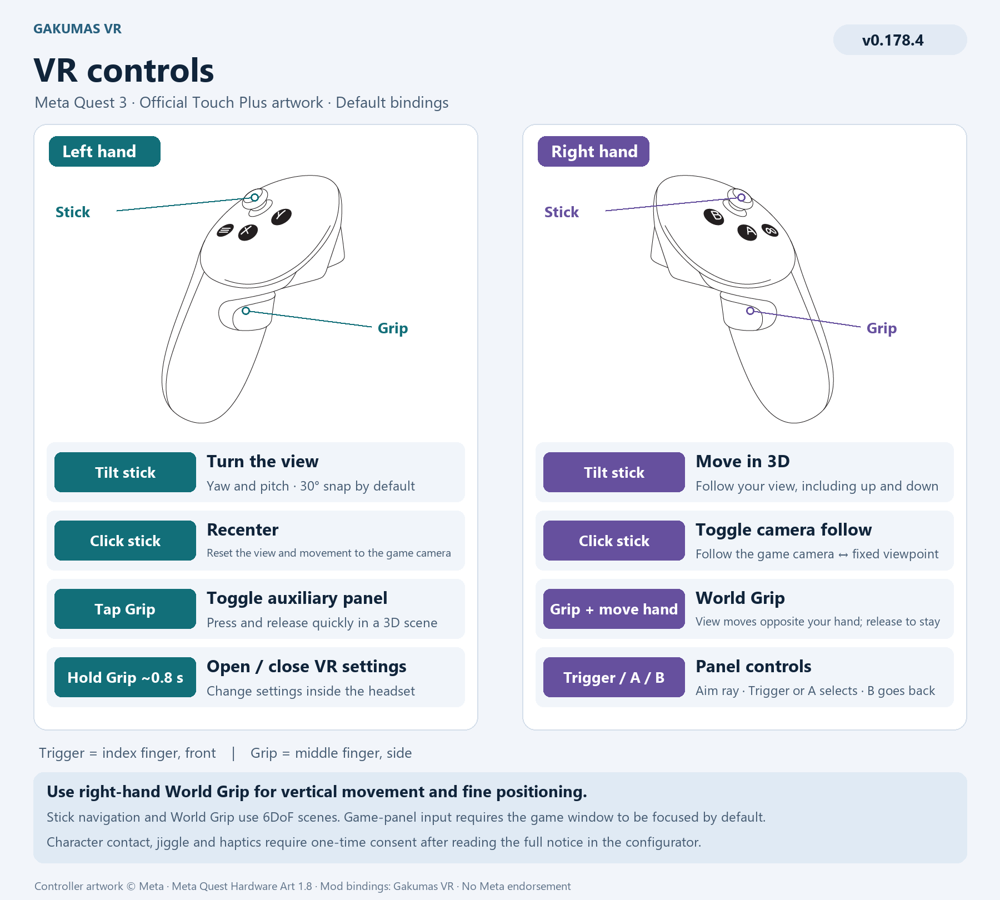

## [English](README.md) | [한국어](README.ko.md) | [日本語](README.ja.md)

# Gakumas VR

Creator: [@TBluebox12](https://x.com/TBluebox12)<br>
ArcaLive virtual reality channel: [가상현실 채널](https://arca.live/b/vrshits)<br>
Support: [buymeacoffee.com/vrshits](https://buymeacoffee.com/vrshits)

Gakumas VR is an unofficial Meta Quest/OpenXR VR mod for the DMM version of Gakuen Idolmaster. Supported 3D scenes are presented in stereo VR, while other content appears on aspect-correct flat panels that can be controlled with VR controllers.

Operation has been tested through VDXR (Virtual Desktop).

[Download a release](https://github.com/deadpixel134/gakumas-vr/releases) · [Full installation guide](docs/en/INSTALLATION.md) · [Full controls guide](docs/en/USAGE.md)

## Requirements

- Windows 11 x64 and a working **DMM edition** installation of Gakuen Idolmaster — targets Unity 6000.0.77f1
- A Meta Quest and a PC VR setup with OpenXR support
- **Virtual Desktop / VDXR:** the path hardware-tested by this project

SteamVR OpenXR and Meta Quest Link/Air Link are preliminary targets without hardware validation. See the [OpenXR runtime guide](docs/en/INSTALLATION.md#openxr-runtimes) for each setup.

## 1. Install

The v0.178.2 installer automatically detects the game location registered with DMM. Choose from the list if several installations are found, or use **Browse** if detection fails. **Auto-detect** searches again.

1. Download a stable release ZIP from [Releases](https://github.com/deadpixel134/gakumas-vr/releases).
2. Fully close the game and make sure `gakumas.exe` is no longer running.
3. Extract the ZIP to a **separate folder outside the game directory**.
4. Run `GakumasVR.Installer.exe`.
5. Select the game directory containing `gakumas.exe`, `GameAssembly.dll`, and `UnityPlayer.dll`, then select **Install**.
6. Once complete, select **Open settings** to review the configuration. You can start with the defaults.

The release ZIP includes the required Dobby binary. The installer checks package hashes and required components before writing files, and backs up files it replaces under `game directory\vrmod\rollback\`. Existing Localify translations, fonts, textures, and settings are preserved.

### Already installed? Update

The configurator **automatically checks GitHub for the latest stable release when opened**. Installation is deferred while the game is running. Results and errors appear in the status bar at the bottom of the GUI. Use **Check for updates** to check again manually.

> **Starting with v0.178.2,** a short release-notes preview will let you choose **Update / Later**, with **Full release notes** opening the GitHub page. Existing installations need that GUI update before the preview becomes available.

1. Fully close the game.
2. Run `game directory\vrmod\tools\GakumasVR.Configurator.exe` and select **Check for updates**.
3. If a new version is available, follow the prompts to download, verify, and install it.

To update manually, download a new ZIP from [Releases](https://github.com/deadpixel134/gakumas-vr/releases), extract it to a separate folder, and run the new `GakumasVR.Installer.exe` against the **same game directory**. Existing user settings are preserved, and replaced files are backed up for rollback.

## 2. Launch in VR

These steps use the hardware-tested Virtual Desktop / VDXR path.

1. Connect your Quest to the PC using **Virtual Desktop**.
2. In **Virtual Desktop Streamer** on the PC, select **VDXR / Virtual Desktop OpenXR** as the active OpenXR runtime.
3. From the desktop inside your headset, open the **DMM launcher** and start the game.
4. Keep the game window in the Windows foreground to use VR controller input.

Launch through the **desktop DMM launcher instead of Virtual Desktop's Games tab**. SteamVR does not need to be running for this path.

## 3. Learn the display and controls

Supported **3D scenes**, including Live, Home, and Communications, appear in **stereo VR**. **2D screens**, such as menus, automatically appear on a flat panel in front of you. The display switches with the scene.

To use the game UI in a 3D scene, **press the left Grip to show the auxiliary panel**, bring your left hand into view, then point and click with the right controller. This panel starts off and is visible only while your left hand is in view. The front panel used for 2D screens appears automatically and cannot be hidden with Grip.



| Action | Default input |
|---|---|
| Aim at the panel | Point with the right controller |
| Click / hold and drag | A button or right trigger |
| Back | B button (`Esc`) |
| Move in 3D | Right thumbstick |
| World grip movement / fine positioning | Hold right Grip and move your hand |
| Turn the view | Left thumbstick — 30° snap by default |
| Recenter the viewpoint | Click the left thumbstick |
| Toggle game camera follow / fixed viewpoint | Click the right thumbstick |
| Show / hide the 3D auxiliary panel | Press and release left Grip quickly |
| Open / close in-headset VR settings | Hold left Grip for about 0.8 seconds |

Right-stick movement follows your current view direction. Looking up or down while moving forward makes you ascend or descend. **For vertical movement or fine positioning, use world grip with the right Grip.** Hold right Grip and move your hand to move the viewpoint in the opposite direction; release Grip to keep that position. Live uses 6DoF head position and rotation by default, with a viewpoint independent of the game's direction camera.

If pulling the trigger disturbs your aim, use **A** to click. By default, VR input is sent only while the game window is in the foreground. You can also use the mouse. Direct touch and thumbstick scrolling are unsupported.

## 4. Change settings

Fully close the game, run the program below, save your changes, and start the game again.

```text
game directory\vrmod\tools\GakumasVR.Configurator.exe
```

Select **Korean, English, or Japanese** at the top.

| What to adjust | Settings |
|---|---|
| Image quality and performance | Per-eye render scale — 0.50–2.00; values above 1.00 increase rendering load |
| Character size and stereo depth | Separate Live / non-Live spatial and scale profiles; eye spacing, head movement, and stick movement scales |
| Panel placement and size | Panel hand, initial visibility, position, size, rotation, and viewer-facing behavior |
| Controls | Pointer hand, click/back buttons, movement hand and speed, snap / smooth turning |
| Visual effects | VFX presets and individual effects |

Selecting the left hand for movement assigns view turning to the right stick. The default movement speed is 1.95m/s, and snap angles of 15° / 30° / 45° / 60° are available. See [Usage and controls](docs/en/USAGE.md) for details.

## Uninstall or roll back

Close the game, run `GakumasVR.Installer.exe` from the release folder, select the game directory, and choose **Uninstall** or the available **Rollback** action.

See the [installation guide](docs/en/INSTALLATION.md) for preservation and restoration details.

## Troubleshooting

| Symptom | Check first |
|---|---|
| VR does not appear | PC VR connection, active OpenXR runtime, and presence of `BepInEx/core/dobby.dll` |
| Display works but clicks do not | Bring the game window to the Windows foreground |
| Auxiliary panel is missing in 3D | Toggle it with left Grip and bring your left hand into view |
| Settings do not apply | Save with the game fully closed, then relaunch |
| Some scenes become flat after a game update | Unity / rendering internals may have changed — check support status and new releases |

If problems persist, close the game and uninstall or roll back. Before attaching files from `vrmod/logs/` to an issue, check for account identifiers, viewer IDs, tokens, or launch authentication data.

## Further documentation and development

- [Installation](docs/en/INSTALLATION.md) · [Usage and controls](docs/en/USAGE.md)
- [Architecture](docs/en/ARCHITECTURE.md)
- [Reusable VR interaction and pose-composition specification](docs/en/VR_INTERACTION_SPEC.md)
- [Developer guide](vrmod/README.md) (Korean)
- [Current status](docs/GAKUMAS_VR_STATUS.md) · [Design record](docs/GAKUMAS_VR_DESIGN.md) · [Milestones](docs/VR_MILESTONES.md) · [Changelog](vrmod/CHANGELOG.md) (Korean)

## License and rights

This repository does not contain game files, Localify assets, user settings, logs, rollback data, or build outputs. Project source is released under the [MIT License](LICENSE); third-party components retain their own licenses. See [Credits and third-party licenses](CREDITS.md).

> Gakumas VR is an unofficial fan project and is not affiliated with the game's developer or publisher. The game, trademarks, and related works belong to their respective owners. A legitimate game installation is required.
