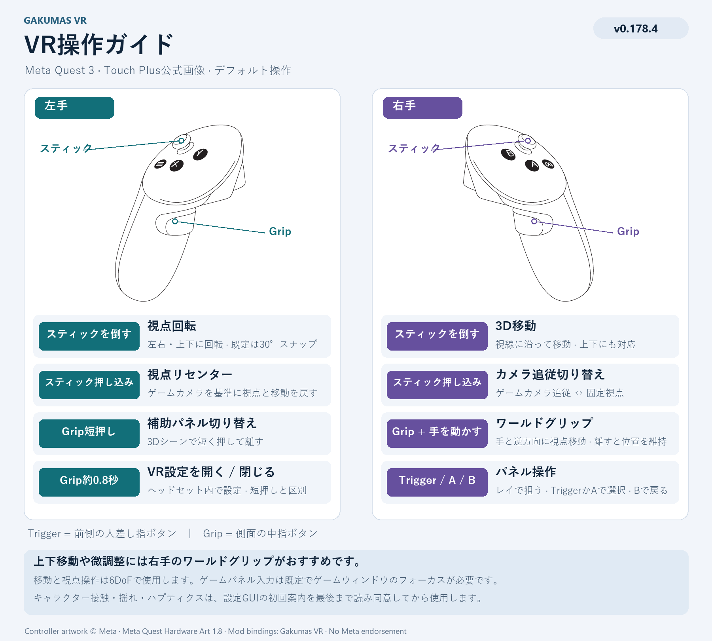

## [English](README.md) | [한국어](README.ko.md) | [日本語](README.ja.md)

# Gakumas VR

制作者: [@TBluebox12](https://x.com/TBluebox12)<br>
アカライブ 仮想現実チャンネル: [가상현実チャンネル](https://arca.live/b/vrshits)<br>
支援: [buymeacoffee.com/vrshits](https://buymeacoffee.com/vrshits)

Gakumas VRは、学園アイドルマスターDMM版向けの非公式Meta Quest／OpenXR VR Modです。対応する3Dシーンを両眼VRで表示し、それ以外の画面はアスペクト比を維持した平面パネルとして表示して、VRコントローラーで操作できます。

VDXR（Virtual Desktop）での動作テストを完了しています。

[リリースをダウンロード](https://github.com/deadpixel134/gakumas-vr/releases) · [詳しいインストール手順](docs/ja/INSTALLATION.md) · [詳しい操作方法](docs/ja/USAGE.md)

## 必要なもの

- Windows 11 x64と、正常にインストールされた学園アイドルマスターの**DMM版** — Unity 6000.0.77f1基準
- Meta Questと、OpenXRを利用できるPC VR環境
- **Virtual Desktop / VDXR:** 本プロジェクトで実機確認済みの起動経路

SteamVR OpenXRとMeta Quest Link／Air Linkは予備対応で、実機未確認です。各経路の設定は[OpenXRランタイムの案内](docs/ja/INSTALLATION.md#openxrランタイム)を参照してください。

## 1. インストールする

v0.178.3のインストーラーは、DMMに登録されたゲームのインストール先を自動検出します。複数ある場合は一覧から選択し、見つからない場合は**参照**で選択してください。**自動検出**で再検索もできます。

1. [Releases](https://github.com/deadpixel134/gakumas-vr/releases)から正式リリースのZIPをダウンロードします。
2. ゲームを完全に終了し、`gakumas.exe`が実行中でないことを確認します。
3. ZIPを**ゲームフォルダー外の別フォルダー**へ展開します。
4. `GakumasVR.Installer.exe`を実行します。
5. `gakumas.exe`、`GameAssembly.dll`、`UnityPlayer.dll`があるゲームフォルダーを選択し、**インストール**を押します。
6. 完了後に**設定を開く**を押して設定を確認します。最初はデフォルト値で始められます。

必要なDobbyは配布ZIPに含まれます。インストーラーは書き込み前にパッケージのハッシュと必須構成を確認し、置き換える既存ファイルを`ゲームフォルダー\vrmod\rollback\`にバックアップします。既存のLocalifyの翻訳・フォント・テクスチャ・設定は保持します。

### インストール済みの場合：更新する

設定GUIは起動時にGitHubの**最新正式リリースを自動確認**します。ゲーム実行中はインストールを保留し、確認結果やエラーはGUI下部のステータス欄に表示します。**更新を確認**ボタンで手動の再確認もできます。

> **v0.178.3以降**は、新バージョンのリリースノートを簡潔に表示し、**更新／後で**を選べるようになります。**リリースノート全文**でGitHubの原文を開けます。既存の環境では新しいGUIへの更新後に利用できます。

1. ゲームを完全に終了します。
2. `ゲームフォルダー\vrmod\tools\GakumasVR.Configurator.exe`を実行し、**更新を確認**を押します。
3. 新しいバージョンがある場合は、案内に従ってダウンロード・検証・インストールを進めます。

手動で更新する場合は、[Releases](https://github.com/deadpixel134/gakumas-vr/releases)から新しいZIPをダウンロードして別フォルダーへ展開し、新しい`GakumasVR.Installer.exe`で**以前と同じゲームフォルダー**を選択してインストールします。既存のユーザー設定は保持し、置き換えるファイルはロールバック用にバックアップします。

## 2. VRで起動する

以下は実機確認済みのVirtual Desktop / VDXRを使う手順です。

1. Questから**Virtual Desktop**でPCへ接続します。
2. PCの**Virtual Desktop Streamer**で**VDXR / Virtual Desktop OpenXR**をアクティブなOpenXRランタイムに設定します。
3. ヘッドセット内のデスクトップで**DMMランチャー**を開き、ゲームを起動します。
4. ゲームウィンドウをWindowsの最前面にして、VRコントローラーで操作します。

Virtual Desktopの**Gamesタブではなく、デスクトップのDMMランチャー**から起動してください。この経路ではSteamVRを別途起動する必要はありません。

## 3. 表示と基本操作を覚える

ライブ・ホーム・コミュなど、対応する**3Dシーンは両眼VR**で表示します。メニューなどの**2D画面は正面の平面パネル**に自動表示し、シーンに応じて表示方式を切り替えます。

3DシーンでゲームUIを操作するには、**左Gripで補助パネルを表示**し、左手を視野に入れてから右手で指してクリックします。補助パネルは初期状態でOFFで、ONでも左手が視野外にあると表示されません。2D画面の正面パネルは自動表示され、Gripでは消せません。



| 操作 | デフォルト入力 |
|---|---|
| パネルのカーソルを合わせる | 右コントローラーで指す |
| クリック／長押しドラッグ | Aボタンまたは右トリガー |
| 戻る | Bボタン（`Esc`） |
| 3D空間の移動 | 右スティック |
| ワールドグリップで移動／微調整 | 右Gripを押しながら手を動かす |
| 視点回転 | 左スティック — デフォルト30°スナップ |
| 視点のリセンター | 左スティックを押し込む |
| ゲームカメラ追従／固定視点の切り替え | 右スティックを押し込む |
| 3D補助パネルの表示／非表示 | 左Gripを短く押して離す |
| ヘッドセット内のVR設定を開く／閉じる | 左Gripを約0.8秒長押し |

右スティックの移動は現在見ている方向に従います。上や下を見ながら前進すると上昇・下降します。**上下の移動や位置の微調整には、右Gripを使うワールドグリップがおすすめです。** 右Gripを押しながら手を動かすと、手の移動と反対方向に視点が移動し、Gripを離すとその位置を保持します。ライブでは頭の位置と回転を反映する6DoFがデフォルトで有効で、ゲームの演出カメラから独立した視点を使用します。

クリック時に照準がずれる場合は、トリガーの代わりに**Aボタン**を使ってください。デフォルトではゲームウィンドウが最前面にあるときだけVR入力を送ります。マウスも併用できます。直接タッチとスティックスクロールには対応していません。

## 4. 設定を変える

全機能版には手の表示と、キャラクターとの接触・変形・揺れ・ハプティクス・接触マーカーの設定を含みます。**キャラクター接触タブの初回案内を最後まで読んで同意する必要があります。** 同意はユーザーごとに一度記録し、同意前は以前の設定が有効でも反応を遮断します。キャラクターや衣装によって反応は異なります。

ゲームを完全に終了し、以下のプログラムで設定を変更・保存してからゲームを再起動します。

```text
ゲームフォルダー\vrmod\tools\GakumasVR.Configurator.exe
```

上部で**韓国語・英語・日本語**を選択できます。

| 調整したい項目 | 設定内容 |
|---|---|
| 画質と性能 | 片目ごとのレンダー倍率 — 0.50～2.00、1.00を超えると描画負荷が増加 |
| キャラクターの大きさと立体感 | ライブ／非ライブ別の空間・スケールプロファイル、目の間隔・頭の移動・スティック移動の倍率 |
| パネルの位置と大きさ | パネル側の手、開始状態、位置・サイズ・回転、プレイヤー向き |
| 操作方法 | ポインター側の手、クリック／戻るボタン、移動側と速度、スナップ／スムーズ回転 |
| 画面効果 | VFXプリセットと個別の効果 |

移動側を左手に変えると、右スティックが視点回転を担当します。デフォルトの移動速度は1.95m/sで、スナップ角度は15° / 30° / 45° / 60°から選べます。詳細は[使い方と操作方法](docs/ja/USAGE.md)を参照してください。

## アンインストールとロールバック

ゲームを終了し、配布フォルダーの`GakumasVR.Installer.exe`でゲームフォルダーを選択して、**アンインストール**または表示される**ロールバック**を実行します。

保持・復元の方針と詳しい手順は[インストールの案内](docs/ja/INSTALLATION.md)を参照してください。

## 困ったとき

| 症状 | 最初に確認すること |
|---|---|
| VR画面が出ない | PC VR接続、アクティブなOpenXRランタイム、`BepInEx/core/dobby.dll`の有無 |
| 表示されるがクリックできない | ゲームウィンドウがWindowsの最前面にあるか確認 |
| 3Dで補助パネルが見えない | 左Gripで表示し、左手を視野に入れる |
| 設定が反映されない | ゲームを完全に終了した状態で保存し、再起動 |
| ゲーム更新後に一部シーンが平面になる | Unity／レンダー構造が変わった可能性 — 対応状況と新しいリリースを確認 |

問題が続く場合は、ゲームを終了してアンインストールまたはロールバックできます。Issueへ`vrmod/logs/`のログを添付する前に、アカウントID、viewer ID、token、起動認証情報が含まれていないことを確認してください。

## 詳細ドキュメントと開発情報

- [インストール](docs/ja/INSTALLATION.md) · [使い方と操作方法](docs/ja/USAGE.md)
- [構成と仕組み](docs/ja/ARCHITECTURE.md)
- [再利用可能なVR操作・ポーズ合成仕様](docs/ja/VR_INTERACTION_SPEC.md)
- [開発者向けガイド](vrmod/README.md)（韓国語）
- [開発状況](docs/GAKUMAS_VR_STATUS.md) · [設計記録](docs/GAKUMAS_VR_DESIGN.md) · [マイルストーン](docs/VR_MILESTONES.md) · [変更履歴](vrmod/CHANGELOG.md)（韓国語）

## ライセンスと権利について

このリポジトリにはゲーム本体、Localifyアセット、ユーザー設定、ログ、ロールバックデータ、ビルド成果物は含まれません。プロジェクトのソースは[MIT License](LICENSE)で公開し、外部コンポーネントにはそれぞれのライセンスが適用されます。[クレジットと外部ライセンス](CREDITS.md)も参照してください。

> Gakumas VRは非公式のファンプロジェクトであり、ゲームの開発元・運営元とは関係ありません。ゲーム、商標、関連著作物の権利は各権利者に帰属します。正規にインストールされたゲームが必要です。
