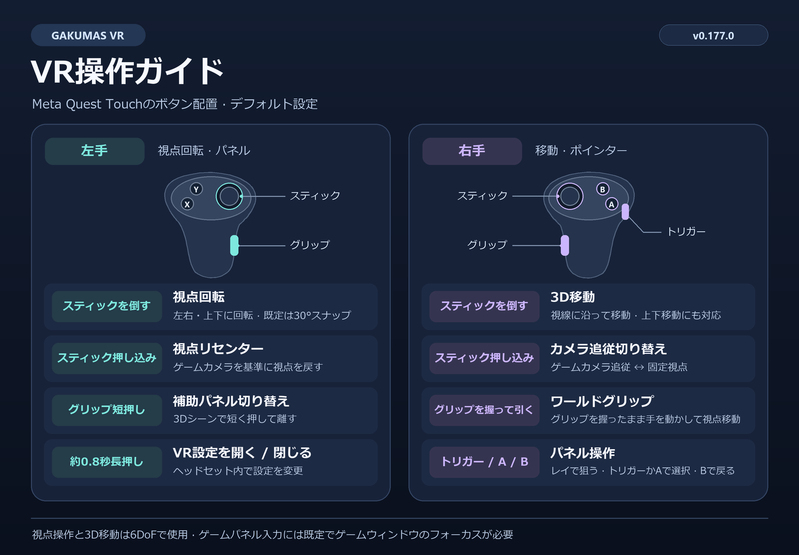

[한국어](README.md) | [English](README.en.md) | [日本語](README.ja.md)

# Gakumas VR

制作者: [@TBluebox12](https://x.com/TBluebox12)  
アカライブ 仮想現実チャンネル: [가상현実チャンネル](https://arca.live/b/vrshits)  
支援: [buymeacoffee.com/vrshits](https://buymeacoffee.com/vrshits)

Gakumas VRは、学園アイドルマスターDMM版向けの非公式Meta Quest／OpenXR VR Modです。対応する3Dシーンを両眼VRで表示し、それ以外の画面はアスペクト比を維持した平面パネルとして表示して、VRコントローラーで操作できます。

主要な6DoF操作は、v0.173までにMeta Quest 2とVDXR（Virtual Desktop）で実機確認済みです。現在の公開版は [v0.178.1](https://github.com/deadpixel134/gakumas-vr/releases/tag/v0.178.1) です。SteamVR OpenXRとMeta Quest Linkは予備対応です。

## VR操作ガイド

## ドキュメント

- [インストール](docs/ja/INSTALLATION.md)
- [VR操作ガイド](docs/ja/CONTROLS.md)
- [使い方](docs/ja/USAGE.md)
- [構成と仕組み](docs/ja/ARCHITECTURE.md)
- [再利用可能なVR操作・ポーズ合成仕様](docs/ja/VR_INTERACTION_SPEC.md)
- [開発者向けガイド](vrmod/README.md)（韓国語）
- [開発状況](docs/GAKUMAS_VR_STATUS.md) · [設計記録](docs/GAKUMAS_VR_DESIGN.md) · [マイルストーン](docs/VR_MILESTONES.md) · [変更履歴](vrmod/CHANGELOG.md)（韓国語）

## 主な機能

- ライブ、ホーム、コミュなど対応する3D環境のOpenXRステレオ表示
- 2D画面の自動正面パネルと、3D画面の左手補助パネル
- 右手3D移動、左手ワールド軸視点回転、デフォルト30°スナップ
- 右手レイポインター、A／トリガークリック、Bで戻る
- 手の表示、キャラクター接触による変形・揺れ・コントローラー振動、接触位置・範囲の表示切り替え
- キャラクター接触の初回同意案内：案内を最後まで読んで同意すると有効になり、同意前は既存の設定にかかわらず無効
- 韓国語・英語・日本語対応のインストーラーと設定ツール
- レンダー倍率、立体感、パネル配置、左右の手、ボタン、VFXの設定
- ログ保存は初期値OFF、初回更新時の既存VRログ整理、設定GUIでの保存・容量確認・削除管理
- 既存のLocalifyファイルと設定を保持するインストール／アンインストール

キャラクター接触は実験的な機能です。キャラクターや衣装によって対応状況と反応が異なる場合があります。

## 重要な制限

- Windows 11 x64、DMM版、Unity 6000.0.77f1を対象とする正式リリースです。
- 配布ZIPには必要なDobbyが含まれます。v0.178.1インストーラーはゲームフォルダーへ書き込む前に、payload全体のハッシュ、クリーンインストール必須構成、保持ポリシーを事前検証します。
- 問題が発生した場合はゲームを終了し、インストーラーからアンインストールまたはロールバックしてください。Issueにログを添付する前に、アカウント識別子や認証情報が含まれていないことを確認してください。

このリポジトリにはゲーム本体、Localifyアセット、ユーザー設定、ログ、ロールバックデータ、ビルド成果物は含まれません。プロジェクトのソースは[MIT License](LICENSE)で公開し、外部コンポーネントにはそれぞれのライセンスが適用されます。[クレジットと外部ライセンス](CREDITS.md)も参照してください。

> Gakumas VRは非公式のファンプロジェクトであり、ゲームの開発元・運営元とは関係ありません。ゲーム、商標、関連著作物の権利は各権利者に帰属します。正規にインストールされたゲームが必要です。
