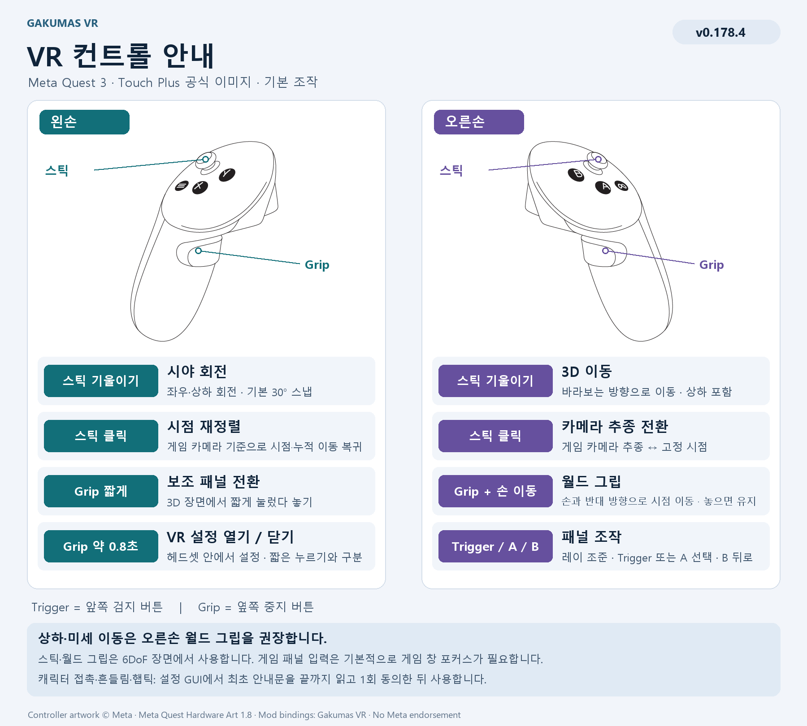

## [English](README.md) | [한국어](README.ko.md) | [日本語](README.ja.md)

# Gakumas VR

제작자: [@TBluebox12](https://x.com/TBluebox12)<br>
아카라이브 가상현실 채널: [가상현실 채널](https://arca.live/b/vrshits)<br>
후원: [buymeacoffee.com/vrshits](https://buymeacoffee.com/vrshits)

학원 아이돌마스터 DMM판을 위한 비공식 Meta Quest/OpenXR VR 모드입니다. 3D 장면은 양안 VR로, 그 밖의 화면은 비율을 보존한 평면 패널로 표시하며 VR 컨트롤러로 게임 UI를 조작할 수 있습니다.

VDXR (Virtual Desktop)을 통한 동작 테스트를 완료했습니다.

[릴리스 다운로드](https://github.com/deadpixel134/gakumas-vr/releases) · [자세한 설치 안내](docs/ko/INSTALLATION.md) · [자세한 조작 안내](docs/ko/USAGE.md)

## 준비물

- Windows 11 x64와 정상 설치된 학원 아이돌마스터 **DMM판** — Unity 6000.0.77f1 기준
- Meta Quest와 OpenXR를 사용할 수 있는 PC VR 환경
- **Virtual Desktop / VDXR:** 이 프로젝트에서 실기 확인한 실행 경로

SteamVR OpenXR와 Meta Quest Link/Air Link는 예비 지원이며 실기 미검증입니다. 경로별 설정은 [OpenXR 런타임 안내](docs/ko/INSTALLATION.md#openxr-런타임)를 참고하십시오.

## 1. 설치하기

v0.178.3 인스톨러는 DMM에 등록된 게임 설치 경로를 자동으로 불러옵니다. 후보가 여러 개면 목록에서 선택하고, 경로를 찾지 못하면 **찾기**로 직접 선택할 수 있습니다. **자동 찾기**로 다시 탐색할 수도 있습니다.

1. [Releases](https://github.com/deadpixel134/gakumas-vr/releases)에서 정식 릴리스 ZIP을 내려받습니다.
2. 게임을 완전히 종료하고 `gakumas.exe`가 실행 중이지 않은지 확인합니다.
3. ZIP을 **게임 폴더 밖의 별도 폴더**에 풉니다.
4. `GakumasVR.Installer.exe`를 실행합니다.
5. `gakumas.exe`, `GameAssembly.dll`, `UnityPlayer.dll`이 있는 게임 폴더를 선택하고 **설치**를 누릅니다.
6. 완료 후 **설정 열기**를 눌러 설정을 확인합니다. 처음에는 기본값으로 시작할 수 있습니다.

필요한 Dobby는 배포 ZIP에 포함되어 있습니다. 설치기는 파일을 쓰기 전에 패키지 해시와 필수 구성을 검사하고, 교체할 기존 파일을 `게임 폴더\vrmod\rollback\`에 백업합니다. 기존 Localify 한글 패치의 번역·폰트·텍스처·설정은 보존합니다.

### 이미 설치했다면: 업데이트하기

설정 GUI는 열릴 때마다 GitHub의 **최신 정식 릴리스를 자동 확인**합니다. 게임 실행 중에는 설치를 보류하며, 확인 결과와 오류는 GUI 하단 상태 표시줄에 나타납니다. **업데이트 확인** 버튼은 수동으로 다시 확인할 때 사용합니다.

> **v0.178.3부터** 새 버전의 릴리스 노트를 간략히 보여주고 **업데이트 / 나중에**를 선택할 수 있습니다. **전체 릴리스 노트**로 GitHub 원문을 열 수 있습니다. 기존 설치본에는 새 GUI로 업데이트한 뒤 적용됩니다.

1. 게임을 완전히 종료합니다.
2. `게임 폴더\vrmod\tools\GakumasVR.Configurator.exe`를 실행하고 **업데이트 확인**을 누릅니다.
3. 새 버전이 있으면 안내에 따라 다운로드·검증·설치를 진행합니다.

수동 업데이트는 [Releases](https://github.com/deadpixel134/gakumas-vr/releases)에서 새 ZIP을 내려받아 별도 폴더에 푼 뒤, 새 `GakumasVR.Installer.exe`에서 **기존과 같은 게임 폴더**를 선택해 설치합니다. 기존 사용자 설정은 보존되며, 교체되는 파일은 롤백 폴더에 백업됩니다.

## 2. VR로 실행하기

다음은 실기 확인된 Virtual Desktop / VDXR 기준입니다.

1. Quest에서 **Virtual Desktop**으로 PC에 연결합니다.
2. PC의 **Virtual Desktop Streamer**에서 **VDXR / Virtual Desktop OpenXR**를 활성 OpenXR 런타임으로 지정합니다.
3. 헤드셋 안의 데스크톱에서 **DMM 런처**를 열고 게임을 실행합니다.
4. 게임 창을 Windows의 포그라운드에 두고 VR 컨트롤러로 조작합니다.

Virtual Desktop의 **Games 탭 대신 데스크톱의 DMM 런처**로 실행하십시오. 이 경로에서는 SteamVR를 별도로 실행할 필요가 없습니다.

## 3. 화면과 기본 조작 익히기

라이브·홈·커뮤니케이션 등 지원되는 **3D 장면은 양안 VR**로 표시됩니다. 메뉴 등 **2D 화면은 시야 정면의 평면 패널**로 자동 표시되며, 장면에 따라 두 표시 방식이 전환됩니다.

3D 장면에서 게임 UI를 조작하려면 **왼손 Grip으로 보조 패널을 켜고**, 패널이 시야 안에 들어오도록 왼손을 든 뒤 오른손으로 가리켜 클릭하십시오. 보조 패널은 기본적으로 꺼져 있고, 켜져 있어도 왼손이 시야 밖에 있으면 보이지 않습니다. 2D 화면의 정면 패널은 자동 표시되며 Grip으로 끌 수 없습니다.

[](docs/ko/CONTROLS.md)

| 동작 | 기본 입력 |
|---|---|
| 패널의 커서 조준 | 오른손 컨트롤러로 가리키기 |
| 클릭 / 누른 채 드래그 | A 버튼 또는 오른손 트리거 |
| 뒤로 가기 | B 버튼 (`Esc`) |
| 3D 공간 이동 | 오른손 스틱 |
| 월드 그립으로 이동 / 미세 조정 | 오른손 Grip을 누른 채 손 이동 |
| 시야 회전 | 왼손 스틱 — 기본 30° 스냅 턴 |
| 시점 재정렬 | 왼손 스틱 클릭 |
| 게임 카메라 추종 / 고정 시점 전환 | 오른손 스틱 클릭 |
| 3D 보조 패널 켜기 / 끄기 | 왼손 Grip을 짧게 눌렀다 놓기 |
| 헤드셋 안의 VR 설정 열기 / 닫기 | 왼손 Grip을 약 0.8초 누르기 |

오른손 스틱 이동은 현재 바라보는 방향을 따릅니다. 위나 아래를 보면서 전진하면 상승하거나 하강합니다. **위·아래로 이동하거나 위치를 미세 조정할 때는 오른손 Grip을 이용한 월드 그립을 권장합니다.** 오른손 Grip을 누른 채 손을 움직이면 손 이동의 반대 방향으로 시점이 이동하고, Grip을 놓으면 그 위치가 유지됩니다. 라이브에서는 기본적으로 머리의 위치·회전이 반영되는 6DoF가 켜져 있으며, 게임의 연출 카메라와 독립된 시점을 사용합니다.

클릭할 때 조준이 흔들리면 트리거 대신 **A 버튼**을 사용해 보십시오. 기본 설정에서는 게임 창이 포그라운드에 있을 때만 VR 입력이 전달됩니다. 마우스도 함께 사용할 수 있으며, 직접 터치와 스틱 스크롤은 지원하지 않습니다.

## 4. 설정 바꾸기

전체 배포판에는 손 표시와 캐릭터 접촉·변형·흔들림·햅틱·접촉 표식 설정이 포함됩니다. **캐릭터 접촉 탭의 최초 안내문을 끝까지 읽고 동의해야** 접촉 기능을 사용할 수 있습니다. 동의는 사용자별로 한 번 기록되며, 동의 전에는 기존 설정이 켜져 있어도 접촉 반응이 차단됩니다. 캐릭터·의상에 따라 반응이 달라질 수 있습니다.

게임을 완전히 종료한 뒤 아래 프로그램을 실행하고, 값을 바꿔 저장한 후 게임을 다시 실행합니다.

```text
게임 폴더\vrmod\tools\GakumasVR.Configurator.exe
```

상단에서 **한국어·영어·일본어**를 선택할 수 있습니다.

| 바꾸고 싶은 항목 | 설정할 내용 |
|---|---|
| 화질과 성능 | 눈별 렌더 배율 — 0.50~2.00, 1.00 초과 시 렌더 부하 증가 |
| 캐릭터 크기와 입체감 | 라이브 / 비라이브 공간·크기 프로필, 눈 간격·머리 이동·스틱 이동 배율 |
| 패널 위치와 크기 | 패널 손, 시작 상태, 위치·크기·회전, 플레이어 방향 정렬 |
| 조작 방식 | 포인터 손, 클릭·뒤로 버튼, 이동 손·속도, 스냅 / 연속 회전 |
| 화면 효과 | VFX 프리셋과 세부 효과 |

이동 손을 왼손으로 바꾸면 오른손 스틱이 시야 회전을 담당합니다. 기본 이동 속도는 1.95m/s이며, 스냅 각도는 15° / 30° / 45° / 60° 중 선택할 수 있습니다. 자세한 설명은 [사용 방법과 조작법](docs/ko/USAGE.md)을 참고하십시오.

## 제거와 롤백

게임을 종료한 뒤 배포 폴더의 `GakumasVR.Installer.exe`에서 게임 폴더를 선택하고 **제거** 또는 제공되는 **롤백**을 실행합니다.

보존·복원 정책과 세부 절차는 [설치 안내](docs/ko/INSTALLATION.md)를 참고하십시오.

## 문제가 생겼을 때

| 증상 | 먼저 확인할 내용 |
|---|---|
| VR 화면이 나오지 않음 | PC VR 연결, 활성 OpenXR 런타임, `BepInEx/core/dobby.dll` 존재 여부 |
| 화면은 나오지만 클릭되지 않음 | 게임 창이 Windows 포그라운드에 있는지 확인 |
| 3D에서 보조 패널이 안 보임 | 왼손 Grip으로 켰는지, 왼손이 시야 안에 있는지 확인 |
| 설정이 적용되지 않음 | 게임을 완전히 종료한 상태에서 저장한 뒤 재실행 |
| 게임 업데이트 후 일부 장면이 평면으로 표시됨 | Unity / 렌더 구조 변경 가능성 — 지원 상태와 새 릴리스 확인 |

문제가 계속되면 게임을 종료한 뒤 제거하거나 롤백할 수 있습니다. 이슈에 `vrmod/logs/`의 로그를 첨부하기 전 계정 식별자, viewer ID, token, 실행 인증 정보가 없는지 확인하십시오.

## 상세 문서와 개발 정보

- [설치 방법](docs/ko/INSTALLATION.md) · [사용 방법과 조작법](docs/ko/USAGE.md)
- [프로그램 구조와 동작 방식](docs/ko/ARCHITECTURE.md)
- [재사용 가능한 VR 조작·포즈 합성 명세](docs/ko/VR_INTERACTION_SPEC.md)
- [개발자 안내](vrmod/README.md)
- [현재 개발 상태](docs/GAKUMAS_VR_STATUS.md) · [설계 기록](docs/GAKUMAS_VR_DESIGN.md) · [마일스톤](docs/VR_MILESTONES.md) · [변경 기록](vrmod/CHANGELOG.md)

## 라이선스와 권리 안내

이 저장소에는 게임 원본 파일, Localify 에셋, 사용자 설정, 로그, 롤백 데이터와 빌드 산출물을 포함하지 않습니다. 프로젝트 소스는 [MIT License](LICENSE)로 배포되며 외부 구성 요소는 각자의 라이선스를 따릅니다. 자세한 내용은 [크레딧 및 외부 라이선스](CREDITS.md)를 참고하십시오.

> Gakumas VR은 비공식 팬 프로젝트이며 게임 개발사·배급사와 관련이 없습니다. 게임과 관련 상표·저작물의 권리는 각 권리자에게 있습니다. 사용하려면 정식으로 설치한 게임이 필요합니다.
