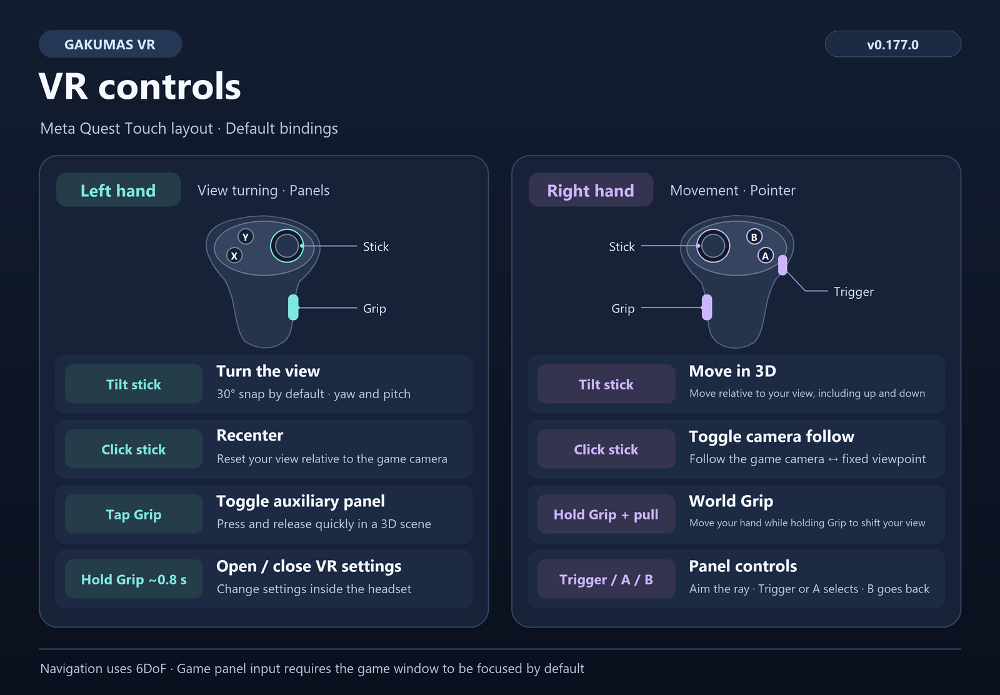

[한국어](../ko/CONTROLS.md) | [English](CONTROLS.md) | [日本語](../ja/CONTROLS.md)

# Gakumas VR controls

This guide uses the v0.177.0 defaults and the Meta Quest Touch button layout.

## Default controls

| Input | Action |
| --- | --- |
| Tilt the left stick | Turn the view horizontally or vertically. The default snap step is 30°. |
| Click the left stick | Recenter relative to the game camera and clear accumulated stick movement, turning, and World Grip movement. |
| Press and release the left Grip quickly | Toggle the hand-mounted auxiliary panel in 3D scenes. |
| Hold the left Grip for about 0.8 seconds | Open or close the in-headset VR settings menu. |
| Tilt the right stick | Move through 3D space relative to your view. Looking up or down while moving forward also moves you in that direction. |
| Click the right stick | Switch between following the game camera and using a fixed viewpoint. |
| Hold the right Grip and move your hand | World Grip shifts the viewpoint opposite your hand movement. Release Grip to stay at the new position. |
| Aim the right controller | Point the ray at the game panel or VR settings. |
| Right Trigger or A | Select what you are pointing at. On the game panel, hold and move to drag. |
| Right B | Send Back (Esc) on the game panel or close the VR settings menu. |

## Using VR settings

- A and B at the top of the menu select post-processing presets. **Apply** updates the current session. **Save** applies the changes and stores them for future sessions. Some settings are marked **Next session**.
- **Close** or B discards unapplied changes. The menu captures controller input while it is open.
- Changing the movement hand swaps the sticks used for movement and turning. The left stick click still recenters, and the right stick click still toggles camera follow.
- Moving the pointer to the left hand makes X/Y the default select/back buttons. Long Grip follows the configured panel hand. World Grip uses the right Grip when the panel is assigned to the left hand.

Stick navigation and World Grip are available in 6DoF scenes. Flat screens appear automatically on the front panel. With the default settings, the Windows game window must be focused for game panel input.

[Usage](USAGE.md) · [Installation](INSTALLATION.md) · [Project README](../../README.en.md)
