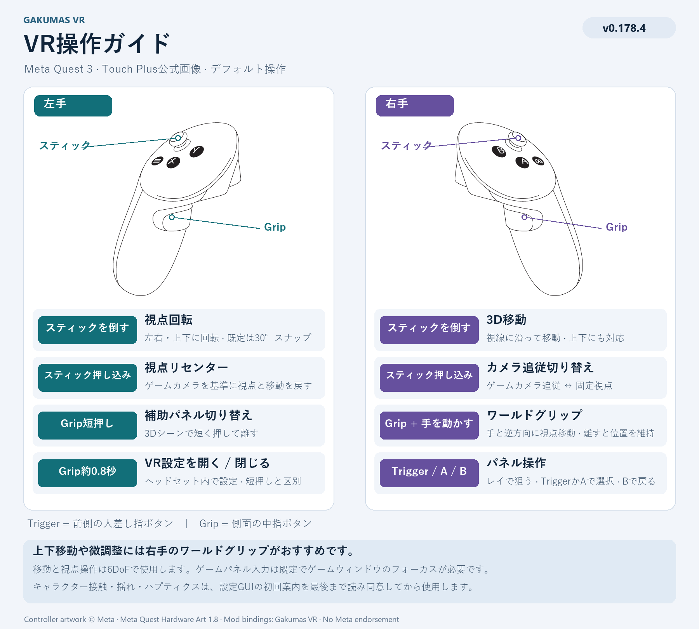

[한국어](../ko/CONTROLS.md) | [English](../en/CONTROLS.md) | [日本語](CONTROLS.md)

# Gakumas VR 操作ガイド

v0.178.4のデフォルト設定と**Meta Quest 3のTouch Plusコントローラー**に基づくガイドです。図には[Meta公式Hardware Art 1.8](https://developers.meta.com/vr/downloads/package/oculus-controller-art/)を使用しています。[元画像・出典・使用条件](../images/meta-quest-touch-plus/SOURCE.md)も確認できます。

## ボタンの位置

- **スティック:** 親指で倒して移動・回転し、内側に押し込むとクリックします。
- **Trigger／トリガー:** 前側にある人差し指で引くボタンです。右トリガーで選択・ドラッグします。
- **Grip／グリップ:** 持ち手の側面にある中指で押すボタンです。左はパネル・VR設定、右はワールドグリップに使います。
- **A/Bは右手、X/Yは左手**にあります。右Metaボタンと左メニューボタンは、このModのリセンター操作ではありません。視点を戻すには**左スティックを押し込みます**。

## デフォルト操作

| 入力 | 動作 |
| --- | --- |
| 左スティックを倒す | 視点を左右・上下に回転します。既定のスナップ角度は30°です。 |
| 左スティックを押し込む | ゲームカメラを基準に視点をリセンターし、スティックでの移動・回転とワールドグリップでの移動をリセットします。 |
| 左グリップを短く押して離す | 3Dシーンで手元の補助パネルの表示を切り替えます。 |
| 左グリップを約0.8秒長押し | ヘッドセット内のVR設定メニューを開くか閉じます。 |
| 右スティックを倒す | 視線を基準に3D空間を移動します。上や下を向いて前進すると、その方向にも移動します。 |
| 右スティックを押し込む | ゲームカメラ追従と固定視点を切り替えます。 |
| 右グリップを握ったまま手を動かす | ワールドグリップで、手の動きと反対方向に視点を移動します。離すと移動後の位置を維持します。 |
| 右コントローラーで狙う | レイポインターでゲームパネルやVR設定を指します。 |
| 右トリガーまたはA | 指した項目を選択します。ゲームパネルでは押したまま動かすとドラッグできます。 |
| 右のB | ゲームパネルで戻る（Esc）を入力するか、開いているVR設定を閉じます。 |

## VR設定の使い方

- メニュー上部のAとBはポストプロセスのプリセットです。**適用**で現在のセッションに反映し、**保存**で次回も使えるように記録します。一部の設定には**次回起動時**と表示されます。
- **閉じる**またはBを押すと、適用していない変更を破棄します。メニューを開いている間はゲームへの入力を遮断します。
- 移動する手の設定を変更すると、スティックを倒したときの移動と視点回転の担当が入れ替わります。押し込み操作は左がリセンター、右がカメラ追従切り替えです。
- ポインターを左手に変更した場合、既定の選択・戻るボタンはX/Yです。グリップ長押しはパネル側の手で行います。ワールドグリップはパネル側が左手のときに使えます。

スティックによる視点操作と移動、ワールドグリップは6DoFシーンで使用できます。平面画面は自動で正面パネルに表示されます。既定の設定でゲームパネルを操作するには、Windowsのゲームウィンドウにフォーカスが必要です。

## 上下移動と微調整

右スティックは現在見ている方向に移動します。**上下移動や位置の微調整には右手のワールドグリップがおすすめです。** 右Gripを押して手を動かすと、視点は手と逆方向に移動します。離すと移動後の位置を維持します。

## キャラクター接触・揺れ・ハプティクス

全機能版には手の表示と、接触・変形・揺れ・ハプティクス・マーカーの設定を含みます。設定GUIの**キャラクター接触**タブで初回案内を最後まで読み、同意してから使用してください。同意はユーザーごとに一度記録し、同意前は以前の設定が有効でも反応を遮断します。ボタンによる自動接触ではありません。対応するシーンで手を動かして接触し、キャラクターや衣装によって反応は異なります。

[使い方](USAGE.md) · [インストール](INSTALLATION.md) · [プロジェクトREADME](../../README.ja.md)
