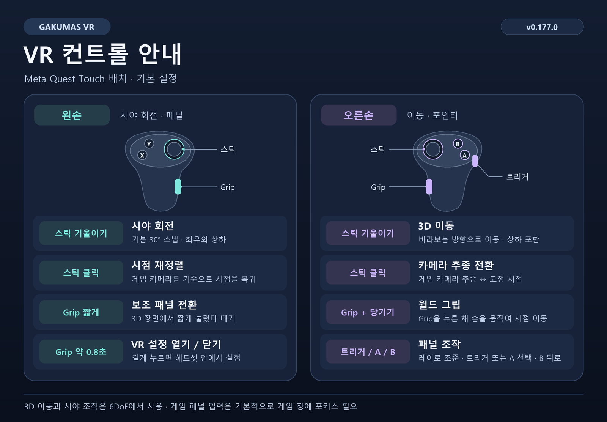

[한국어](CONTROLS.md) | [English](../en/CONTROLS.md) | [日本語](../ja/CONTROLS.md)

# Gakumas VR 컨트롤 안내

v0.177.0 기본 설정과 Meta Quest Touch 버튼 배치를 기준으로 합니다.

## 기본 조작

| 입력 | 동작 |
| --- | --- |
| 왼쪽 스틱 기울이기 | 시야를 좌우·상하로 돌립니다. 기본값은 30° 스냅입니다. |
| 왼쪽 스틱 클릭 | 게임 카메라를 기준으로 시점을 재정렬하고 스틱 이동·회전 및 월드 그립으로 누적된 이동을 초기화합니다. |
| 왼손 Grip 짧게 누른 뒤 놓기 | 3D 장면의 손 보조 패널을 켜거나 끕니다. |
| 왼손 Grip 약 0.8초 누르기 | 헤드셋 안의 VR 설정 메뉴를 열거나 닫습니다. |
| 오른쪽 스틱 기울이기 | 바라보는 방향을 기준으로 3D 공간에서 이동합니다. 위나 아래를 보며 전진하면 그 방향으로도 이동합니다. |
| 오른쪽 스틱 클릭 | 게임 카메라 추종과 고정 시점 사이를 전환합니다. |
| 오른손 Grip을 누른 채 손 움직이기 | 월드 그립으로 시점을 손 움직임과 반대 방향으로 옮깁니다. Grip을 놓으면 이동한 위치를 유지합니다. |
| 오른손으로 조준 | 레이 포인터로 게임 패널이나 VR 설정을 가리킵니다. |
| 오른손 트리거 또는 A | 가리킨 항목을 선택합니다. 게임 패널에서는 누른 채 움직여 드래그할 수도 있습니다. |
| 오른손 B | 게임 패널에서 뒤로 가기(Esc)를 입력하거나 열린 VR 설정을 닫습니다. |

## VR 설정 사용

- 메뉴 상단의 A와 B는 후처리 프리셋입니다. **적용**은 변경을 현재 세션에 반영하고, **저장**은 적용한 값을 다음 실행에도 사용하도록 파일에 기록합니다. 일부 설정에는 **다음 실행/세션** 표시가 있습니다.
- **닫기** 또는 B로 메뉴를 닫으면 적용하지 않은 변경을 버립니다. 메뉴가 열려 있는 동안에는 게임에 입력을 보내지 않습니다.
- 이동 손을 바꾸면 스틱을 기울여 이동하는 손과 시야를 돌리는 손이 맞바뀝니다. 스틱 클릭은 왼쪽 재정렬, 오른쪽 추종 전환입니다.
- 포인터를 왼손으로 바꾸면 기본 선택/뒤로 버튼은 X/Y입니다. Grip 길게 누르기는 설정된 패널 손에서 동작합니다. 월드 그립은 패널 손이 왼손일 때 사용할 수 있습니다.

스틱 조작과 월드 그립은 6DoF 장면에서 사용합니다. 2D 화면은 정면 패널에 자동 표시됩니다. 기본 설정에서는 게임 패널을 조작할 때 Windows 게임 창에 포커스가 필요합니다.

[사용 방법](USAGE.md) · [설치 방법](INSTALLATION.md) · [프로젝트 README](../../README.md)
